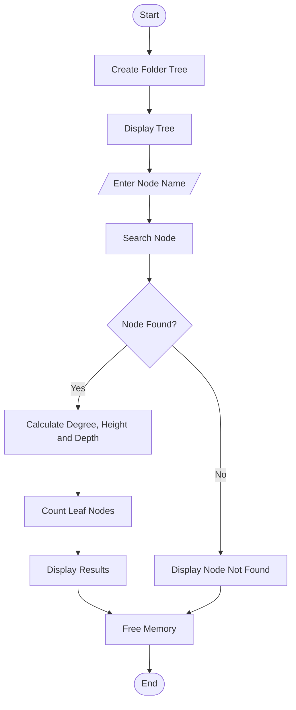

# General-Tree-DSA
Implementation of a computer folder structure using a General Tree in C++ to calculate degree, height, depth, and number of leaf nodes.

# Computer Folder Structure Using a General Tree


## 1. Project Overview

This project represents a computer folder structure using a General Tree in C++.

The program calculates:
- Degree of a given node
- Height of a given node
- Depth of a given node
- Total number of leaf nodes

## 2. Problem Statement

Model a computer folder structure as a general tree.
Compute the degree, height, and depth of a given node
and determine the total number of leaf nodes.

## 3. Objectives

- Understand the General Tree data structure.
- Represent folders and files hierarchically.
- Search for a specific node.
- Calculate degree, height, and depth.
- Count the total number of leaf nodes.
- Implement tree operations using C++.

## 4. Tree Structure

```text
Computer
├── Documents
│   ├── Resume
│   └── Notes
├── Pictures
│   └── Photos
└── Downloads
    └── Software
```

## 5. Definitions

- Degree: Number of direct children of a node.
- Height: Longest downward path from a node to a leaf.
- Depth: Number of edges from the root to a node.
- Leaf Node: A node with no children.
- Number of Leaves: Total leaf nodes in the tree.

## 6. Algorithm

1. Start the program.
2. Create the root node.
3. Create folder and file nodes.
4. Connect the nodes to form a tree.
5. Display the tree structure.
6. Accept a node name from the user.
7. Search for the selected node.
8. Calculate its degree, height, and depth.
9. Count all leaf nodes.
10. Display the results.
11. Release allocated memory.
12. Stop the program.

## 7. Flowchart



## 8. Sample Input

```text
Enter a folder/file name to analyze: Documents
```

## 9. Sample Output

```text
Node name       : Documents
Degree          : 2
Height          : 1
Depth           : 1
Total leaf nodes: 4
```

## 10. Technologies Used

- Programming Language: C++
- Data Structure: General Tree
- Concepts: Recursion, Pointers, Dynamic Memory Allocation
- IDE: Dev-C++

## 11. How to Run

1. Open Dev-C++.
2. Open `GeneralTree.cpp`.
3. Compile the program.
4. Run the executable.
5. Enter a node name.
6. View the calculated results.

## 12. Conclusion

This project demonstrates the application of a General Tree
to represent a computer folder hierarchy.

It uses recursive functions to calculate degree, height,
depth, and the total number of leaf nodes.

The project improves understanding of tree data structures
and their applications in C++.

- Name: Bhagwat Sneha Shantaram
- Class/Division: S.Y Btech (B)
- Subject: Data Structures and Algorithms
