# SnakeList-DSA-CCE-II
A console-based Snake Game in C++ demonstrating Doubly Linked Lists, Queues, Stacks, Dynamic Memory Allocation, and Undo Operations.
# SnakeList – Snake Game Using Linked Lists

## DSA CCE-II | Unit III | C++

### Project Overview

SnakeList is a console-based Snake Game developed using C++.
The project demonstrates the practical implementation of
fundamental Data Structures concepts through an interactive game.

The snake moves around the game board, eats food to increase
its length, and earns points. The game ends if the snake hits
the wall or collides with its own body.

The project also includes power-ups and an undo feature to
demonstrate the use of Queue and Stack data structures.

---

## Problem Statement

Develop a Snake Game in C++ that demonstrates the practical
implementation of linked lists, stacks, queues, pointers,
and dynamic memory allocation.

The snake must move across a grid, consume food, increase
its length, and maintain its body using a linked list.

The program should also provide power-up management using
a queue and undo functionality using a stack.

---

## Objectives

- Implement a Doubly Linked List to represent the snake.
- Implement a Queue using a linked list for power-ups.
- Implement a Stack using a linked list for undo operations.
- Demonstrate pointers and dynamic memory allocation.
- Implement collision detection and score calculation.
- Manage memory using malloc(), calloc(), and free().
- Develop an interactive console-based game using C++.

---

## Data Structures Used

### 1. Doubly Linked List

The snake is represented using a doubly linked list.

Each node stores:
- X-coordinate
- Y-coordinate
- Pointer to the previous node
- Pointer to the next node

The head represents the front of the snake, while the tail
represents its last segment.

When the snake moves, a new head node is created. If the snake
does not eat food, the tail node is removed. If it eats food,
the snake grows.

### 2. Queue Using Linked List

A queue manages the power-ups earned during gameplay.

The queue follows FIFO (First In, First Out).

- Enqueue: Adds a power-up at the rear.
- Dequeue: Removes a power-up from the front.

The player activates the next available power-up using E.

### 3. Stack Using Linked List

A stack stores movement information for undo operations.

The stack follows LIFO (Last In, First Out).

Each node stores the previous tail coordinates, whether the
snake grew, and the movement direction.

The player can press U to undo up to three saved moves,
subject to the available undo count and stored history.

---

## Features

- Interactive Snake Game
- Doubly Linked List-based snake movement
- Queue-based power-up management
- Stack-based undo functionality
- Food generation and score calculation
- Wall collision detection
- Self-collision detection
- Dynamic memory allocation and deallocation
- Live score, snake length, and memory-node display
- Memory cleanup when the game ends

---

## Controls

| Key | Function |
|-----|----------|
| W | Move Up |
| A | Move Left |
| S | Move Down |
| D | Move Right |
| E | Activate the next power-up |
| U | Undo up to three saved moves |
| Q | Quit the game |

---

## Power-Ups

The game supports three types of power-ups.

1. SLOW
   Temporarily slows down the game.

2. SHRINK
   Removes up to two tail segments while maintaining
   a minimum snake length of three.

3. 2X
   Doubles the score for the next food item.

A power-up is added to the queue after every three food items,
provided the queue contains fewer than five power-ups.

---

## Algorithm

1. Initialize the random number generator and keyboard handling.
2. Create the initial snake using a doubly linked list.
3. Initialize the score, direction, undo count, and power-up queue.
4. Generate a food position that does not overlap the snake.
5. Display the game board, score, snake length, and power-ups.
6. Read the player's keyboard input.
7. Update the movement direction or process a power-up or undo.
8. Calculate the snake's next head position.
9. Check whether the snake hits a wall.
10. Check whether the snake collides with its body.
11. Save the movement information in the undo stack.
12. Insert a new head node at the next position.
13. If food is eaten:
    - Increase the score.
    - Increase the food count.
    - Add a power-up when the required condition is satisfied.
    - Generate a new food position.
14. Otherwise, remove the tail node.
15. Repeat until the player quits or the game ends.
16. Restore terminal settings and release allocated memory.
17. Display the final score and remaining node count.

---
## Flowchart

The following flowchart illustrates the complete working of the SnakeList game, including snake movement, food consumption, power-ups, undo operations, collision detection, and memory management.

```mermaid
flowchart TD
    A([START]) --> B[Initialize Random Generator and Keyboard]
    B --> C[Create Initial Snake with 3 Nodes]
    C --> D[Initialize Score, Direction, Undo Count and Counters]
    D --> E[Generate Food at Random Position]
    E --> F[Display Game Board, Score and Data Structure Status]

    F --> G[Read Keyboard Input]

    G --> H{Quit Key Q Pressed?}
    H -- Yes --> Z[Restore Terminal Settings]
    H -- No --> I{Undo Key U Pressed?}

    I -- Yes --> J{Undo Available and Stack Not Empty?}
    J -- Yes --> K[Pop Up to 3 Movement Records]
    K --> L[Restore Previous Snake Positions and Direction]
    L --> M[Decrease Undo Count]
    J -- No --> N{Power-up Key E Pressed?}
    M --> N

    I -- No --> N
    N -- Yes --> O{Power-up Queue Empty?}
    O -- No --> P[Dequeue Next Power-up]
    P --> Q{Power-up Type?}
    Q -- SLOW --> R[Slow Down Game Temporarily]
    Q -- SHRINK --> S[Remove Up to 2 Tail Nodes]
    Q -- 2X --> T[Enable Double Score for Next Food]
    R --> U[Continue Game Loop]
    S --> U
    T --> U
    O -- Yes --> U

    N -- No --> V[Update Direction if Valid]
    U --> V
    V --> W[Calculate Next Head Position]
    W --> X{Head Hits Wall?}

    X -- Yes --> Y[Set Game Over: Wall Collision]
    X -- No --> AA{Next Position Hits Snake Body?}

    AA -- Yes --> AB[Set Game Over: Self Collision]
    AA -- No --> AC[Check Whether Food Is Eaten]

    AC --> AD[Push Movement Record onto Stack]
    AD --> AE[Add New Head Node to Doubly Linked List]
    AE --> AF{Food Eaten?}

    AF -- Yes --> AG[Increase Score and Food Count]
    AG --> AH{Double Score Active?}
    AH -- Yes --> AI[Add 20 Points and Reset Double Score]
    AH -- No --> AJ[Add 10 Points]
    AI --> AK{Every 3 Foods and Queue Below 5?}
    AJ --> AK

    AK -- Yes --> AL[Generate and Enqueue Random Power-up]
    AK -- No --> AM[Generate New Food Position]
    AL --> AM

    AF -- No --> AN[Delete Tail Node]
    AN --> AO[Continue Game Loop]
    AM --> AO
    AO --> F

    Y --> Z
    AB --> Z

    Z --> AP[Free All Remaining Snake Nodes]
    AP --> AQ[Free All Remaining Queue Nodes]
    AQ --> AR[Free All Remaining Stack Nodes]
    AR --> AS[Display Final Score and Remaining Node Count]
    AS --> AT([END])

    classDef terminal fill:#d1fae5,stroke:#059669,color:#064e3b,stroke-width:2px;
    classDef process fill:#dbeafe,stroke:#2563eb,color:#1e3a8a;
    classDef decision fill:#fef3c7,stroke:#d97706,color:#78350f;
    class A,AT terminal;
    class B,C,D,E,F,G,K,L,M,P,R,S,T,U,V,W,AD,AE,AG,AI,AJ,AL,AM,AN,Z,AP,AQ,AR,AS process;
    class H,I,J,N,O,Q,X,AA,AC,AF,AH,AK decision;
```

## Sample Output

Example display format:

+------------------------------+
|                              |
|                              |
|             *                |
|             Ooo              |
|                              |
+------------------------------+

Score:10  Length:4  Undo left:3
Power-up queue:
Stack depth:5  Nodes alive:...

GAME OVER: You quit  Score:10
Nodes still in memory: 0  (no leak)

Note: This is an illustrative example of the output format.
Actual positions, scores, stack depth, and node counts vary
during gameplay.

---

## Memory Management

The project demonstrates dynamic memory management.

- malloc() allocates memory for snake and movement nodes.
- calloc() allocates and zero-initializes power-up nodes.
- free() releases nodes when they are deleted or consumed.

At the end of the game, all remaining snake, queue, and stack
nodes are released.

The program displays the number of tracked nodes still in
memory. A value of zero indicates that all tracked nodes
have been released.

---

## Time Complexity

Let:
- N = number of snake segments
- Q = number of power-ups in the queue
- S = number of saved movement records

| Operation | Time Complexity |
|-----------|-----------------|
| Add snake head | O(1) |
| Add snake tail | O(1) |
| Delete snake head | O(1) |
| Delete snake tail | O(1) |
| Collision checking | O(N) |
| Enqueue power-up | O(1) |
| Dequeue power-up | O(1) |
| Push movement record | O(1) |
| Pop movement record | O(1) |
| Display power-up queue | O(Q) |

---

## Technologies Used

- Programming Language: C++
- Data Structures: Doubly Linked List, Queue, Stack
- Memory Management: malloc(), calloc(), free()
- Libraries: iostream, string, cstdlib, ctime
- Platform-specific keyboard and terminal functions

---

## How to Run

1. Download or clone this repository.
2. Open SnakeList.cpp in a compatible C++ compiler.
3. Compile the program using a compatible environment.
4. Run the generated executable.
5. Use W, A, S, D to control the snake.

For a compatible Linux terminal, a possible compilation command is:

g++ SnakeList.cpp -o SnakeList

Run using:

./SnakeList

The terminal must support the keyboard-handling implementation
used by the program.

---

## Conclusion

SnakeList demonstrates how fundamental data structures can
be applied to an interactive C++ game.

The Doubly Linked List manages the snake's body, the Queue
manages power-ups, and the Stack stores movement history for
undo operations.

The project also illustrates pointers, dynamic memory
allocation, collision detection, and memory cleanup.

It provides a practical understanding of Data Structures
through a simple game-based application.

---

## Author

DSA CCE-II Project
Unit III | C++

